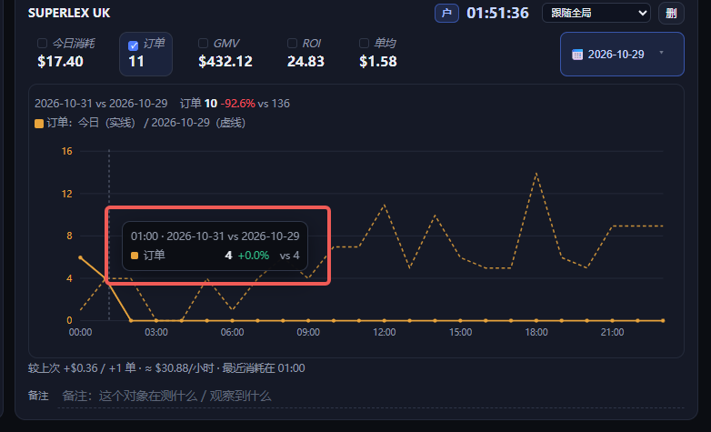
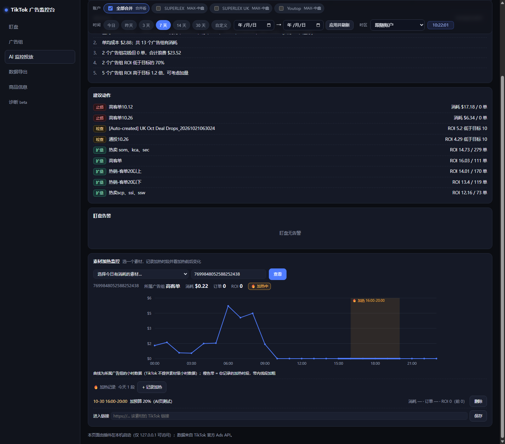

# TikTok Ads Agent Kit · dsh-plugin-tiktok-ads

> 一套给 **AI** 用的 TikTok 广告数据工具：OAuth 授权 → 官方 Ads MCP 直连 → 广告组/素材/SKU 报表 → 实时盯盘面板 → Excel 导出。
>
> 三种接入方式：**DSH 插件**、**命令行 CLI**、**stdio MCP Server**。零运行时依赖，只要 Node.js ≥ 22。

```
广告账户 ──OAuth(PKCE)──▶ TikTok for Business MCP ──▶ 本工具 ──▶ AI / 面板 / Excel
```

---

## 联系作者

互相学习，共同富裕。

有问题或想法，扫码加飞书聊：


> 备注「TikTok 广告工具」即可。

## 直接打开面板（不开 DSH）

面板是一个本地网页，两种打开方式：

| 方式 | 地址 | 说明 |
|---|---|---|
| 双击桌面「TikTok广告监控面板」 | http://127.0.0.1:8795/ | 启动 `tools/open-panel.cmd`；已在运行则直接开页面 |
| DSH 运行时 | http://127.0.0.1:8790/ | 插件随 DSH 自动启动，关掉 DSH 就没了 |

前提：本机代理要开着（默认读 Windows 系统代理，通常是 `127.0.0.1:7890`）。代理没开时面板照样能打开，
会继续显示上次缓存的数据并标注「拉取失败」——把代理打开后点「刷新」即可恢复。

## 商品信息导入（想要 SKU 就靠它）

TikTok 广告接口只给商品 ID（SPU），**SKU 编码和商品名只在卖家中心里**。所以第一次用建议先做这一步，
做完广告组下钻的「SKU」列、SKU 汇总、商品 × 广告合并才有数据。

1. 卖家中心：**商品 → 批量操作 → 编辑商品 → 选择商品 → 模板选「全部信息」→ 生成模板 → 已下载**，拿到 xlsx
2. 面板 → 左侧 **「商品信息」** → 选店铺区域 → 选文件 → **导入**
3. 回「广告组」点任意一行下钻 → 看 SKU 汇总和素材表的 SKU 列

完整图文步骤（含 4 张截图）：**[docs/PRODUCT-IMPORT.md](docs/PRODUCT-IMPORT.md)**

> 没导入也能用，只是 SKU 列会显示 `-`；上新/改 SKU 后重新导出导入一次即可。

---

## 一、概况：重点功能与它们解决的问题

| 功能 | 解决什么问题 | 一句话怎么用 |
|---|---|---|
| **模块化盯盘** | 登后台翻三层菜单才能看到数据；想知道「现在这个组/这条素材跑得怎么样」要来回点 | 点「+ 添加盯盘模块」选账户/组/素材 → 一张卡一个对象，KPI + 小时曲线，自动刷新（默认 60 秒，面板里可改成 15/30 秒） |
| **日期对比 + 累计对比** | 只知道今天消耗多少，判断不出「比昨天好还是差」；更不知道「到下午 4 点为止累计出了多少单」 | 卡片上「📅 日期对比」选昨天/前天/7 天前，双曲线叠加；鼠标悬浮显示到该小时为止的**累计订单 / 累计消耗 / 累计 ROI（均值）** |
| **广告组下钻（SKU + 素材）** | 只知道某个组烧钱，不知道是哪个 SKU、哪条素材在花；素材超 1000 条时后台翻页翻不动 | 广告组列表点任意一行 → 左边 SKU 汇总（消耗/占比/订单/ROI），右边素材表（状态/作品 ID/达人/SKU/CTR），可排序、按状态筛选、搜作品 ID |
| **AI 监控投放** | 每天靠人肉判断「哪个该停、哪个该加」，容易漏 | 一键巡检给出结论 + 建议动作（止损 / 检查 / 扩量）；底部「素材加热监控」可记录加热时段并对比加热前后表现 |
| **数据导出** | 每天手工从后台导 Excel、格式还不统一 | 选日期区间 → 一次生成每天一个 xlsx（商品明细 / 素材明细 / SKU 销量 / 说明），网页直接下载 |
| **商品信息导入** | 广告接口只有商品 ID（SPU），看不到 SKU 编码和商品名 | 导入卖家中心导出的商品表，SKU 列/商品×广告合并立刻有数据（见上一节） |

### 盯盘：一张卡看一个对象，带日期对比



> 卡片上点「📅 日期对比」选历史日期，两条曲线叠加；鼠标悬浮到某个小时，直接看今日值、对比日值和涨跌幅。

### AI 监控投放：把「该停谁、该加谁」说出来



---

## 二、三种接入方式（挑一个）

### 方式 1：DeepSeek Harness 插件（完整能力，含面板）

```text
1) 把本仓库放进 DSH 插件目录：<DSH_HOME>/profiles/<profile>/plugins/dsh-plugin-tiktok-ads
2) profile 的 package.json dependencies 加 "dsh-plugin-tiktok-ads": "link:./plugins/dsh-plugin-tiktok-ads"
3) dsh.profile.bundles 里加入 "dsh-plugin-tiktok-ads"
```

注册 6 个工具：`tiktok_ads_status` / `connect` / `disconnect` / `tools` / `call` / `panel`。
插件会自动启动本地监控面板（默认 `http://127.0.0.1:8790`）。

### 方式 2：命令行（任何能跑命令的 AI 都能用）

```bash
git clone https://github.com/penyy8540-bit/tiktok-ads-agent-kit.git && cd tiktok-ads-agent-kit
node tools/ads-cli.mjs status            # 是否已授权
node tools/ads-cli.mjs login             # 生成授权链接并打开浏览器
node tools/ads-cli.mjs accounts          # 已授权账户 + GMV Max 店铺
node tools/ads-cli.mjs report --days 7   # 近 7 天汇总（JSON）
node tools/ads-cli.mjs creatives --days 1 --pretty
node tools/ads-cli.mjs export --start 2026-10-28 --end 2026-10-28 --out ./reports
node tools/ads-cli.mjs panel --port 8795 # 可视化面板（不依赖 DSH）
```

所有命令**默认输出 JSON**，方便模型直接解析。

### 方式 3：MCP Server（Claude Desktop / Cursor / 任意 MCP 客户端）

```json
{
  "mcpServers": {
    "tiktok-ads": {
      "command": "node",
      "args": ["D:/path/to/dsh-plugin-tiktok-ads/tools/mcp-server.mjs"],
      "env": { "TIKTOK_ADS_PROXY": "auto" }
    }
  }
}
```

暴露的工具：`tiktok_status`、`tiktok_login`、`tiktok_accounts`、`tiktok_report`、
`tiktok_campaigns`、`tiktok_creatives`、`tiktok_tools_search`、`tiktok_call`、`tiktok_export`。

> 更细的 AI 使用说明（提示词模板、字段解释）见 [docs/AI-USAGE.md](docs/AI-USAGE.md)。
> 商品表（SKU / 商品名）怎么从卖家中心导出并导入见 [docs/PRODUCT-IMPORT.md](docs/PRODUCT-IMPORT.md)。

---

## 三、快速开始（5 分钟）

```bash
# 1. 准备：Node.js 22+
node -v

# 2. 授权（会打开浏览器登录 TikTok for Business）
node tools/ads-cli.mjs login

# 3. 验证
node tools/ads-cli.mjs status
node tools/ads-cli.mjs accounts

# 4. 拉数据
node tools/ads-cli.mjs report --days 7 --pretty
```

授权令牌保存在 `~/.dsh/plugin-data/tiktok-ads/auth.json`（权限 0600，**从不打印、不写日志、不返回给模型**）。
访问令牌有效期约 24 小时，过期自动用 refresh token 续期。

### 国内网络 / 代理

默认 `proxy: auto`：先读 `HTTPS_PROXY`，读不到再读 Windows 系统代理。
也可以显式指定：

```bash
TIKTOK_ADS_PROXY=http://127.0.0.1:7890 node tools/ads-cli.mjs status
```

---

## 四、常用数据口径（重要）

| 概念 | 说明 |
|---|---|
| GMV Max 报表工具 | `gmv_max_report_get`（非普通 report） |
| 广告组维度 | `dimensions: ["campaign_id"]` |
| 商品维度 | `dimensions: ["item_group_id"]`，**必须带 `filtering.campaign_ids`** |
| 素材维度 | `dimensions: ["item_id"]`，**必须同时带 `campaign_ids` + `item_group_ids`** |
| 小时数据 | 只有账户 / 广告组级有 `stat_time_hour`，**素材级没有小时数据** |
| 作品 ID | 素材报表里的 `item_id`，TikTok 网页端无法直接打开（只能复制） |
| 时区 | 报表小时口径 = 广告账户时区，面板支持按时区换算展示 |

---

## 五、可视化面板

```bash
node tools/ads-cli.mjs panel --port 8795     # 或 node tools/panel-preview.mjs --port 8795
```

能力：

- **盯盘**：一个对象一张卡，KPI（可点选 2 个做双轴）+ 小时曲线 + 每卡独立时区 + 备注 + **整日对比**（今日 vs 昨天/指定日，双曲线 + 涨跌幅）
- **AI 监控投放 · 素材加热监控**：选一个素材，手动记录「加热时段」（如 16:00-20:00）；曲线上该时段橙色高亮、线段加粗，显示「🔥 加热中」，并自动对比加热前后的消耗/订单/ROI；每个素材可保存一个「进入链接」
- **广告组**：广告组 → SKU 占比 → 素材下钻（状态筛选、排序、作品 ID 搜索、**达人昵称**）
- **AI 监控投放**：规则巡检（结论 / 止损 / 检查 / 扩量动作）＋ 一键复制摘要
- **数据导出**：选日期区间导出与桌面版同格式的 xlsx，可直接在网页下载
- **商品信息**：上传卖家中心导出的商品表，合并商品 × 广告数据（SKU 编码/商品名来自这份表）→ 见上文「商品信息导入」与 [docs/PRODUCT-IMPORT.md](docs/PRODUCT-IMPORT.md)

> 面板只监听 `127.0.0.1`，仅本机可访问。

---

## 六、Excel 导出

```bash
# 单天
node tools/daily-report.mjs --date 2026-10-28 --flat --out ./reports

# 日期区间（每天一个文件）
node tools/ads-cli.mjs export --start 2026-10-20 --end 2026-10-28 --out ./reports
```

每个 xlsx 含：**商品明细 / 素材明细 / SKU 销量 / 说明** 四个 sheet。
导出需要 Python + `openpyxl`（仅导出功能需要；只跑 CLI 报表不需要 Python）。
可用 `PYTHON_PATH` 指定解释器。

---

## 七、配置

优先级：**环境变量 > 插件 config > 默认值**

| 环境变量 | 作用 | 默认 |
|---|---|---|
| `TIKTOK_ADS_DATA_DIR` | 数据目录（令牌、缓存、看板） | `~/.dsh/plugin-data/tiktok-ads` |
| `TIKTOK_ADS_MODE` | `layer`（约 40 工具）/ `flat`（约 400 工具） | `layer` |
| `TIKTOK_ADS_PROXY` | `auto` / `off` / `http://host:port` | `auto` |
| `TIKTOK_ADS_RESOURCE` | 自定义 MCP 端点 | TikTok 官方 layer 端点 |

DSH 插件方式下，这些字段写在 `cordis.patch.yml` 的 `config` 里
（`mode / expose / proxy / callbackPort / dashboardPort / monitorIntervalMinutes / rules` 等）。

---

## 八、安全与隐私

- 令牌只存本地 `auth.json`（0600），**不进入日志、不进入工具返回值、不进入面板 HTML**
- 面板只绑定 `127.0.0.1`
- 代码零第三方依赖，除用户配置的代理外只访问 TikTok 官方域名
- `.gitignore` 已排除 `node_modules/`、`__pycache__/`、`reports/`、本地授权文件

---

## 九、项目结构

```text
lib/
  core.js       与框架无关的核心（OAuth / MCP 会话 / callTool）——插件、CLI、MCP server、独立面板共用同一套
  queries.js    常用查询（账户、广告组报表、素材报表）
  index.js      DSH 插件入口（注册 6 个工具 + 启动面板）
  oauth.js      OAuth DCR + PKCE + 本地回调
  transport.js  零依赖 HTTPS / CONNECT 代理
  mcp.js        MCP Streamable HTTP 客户端
  registry.js   工具目录检索
  panel.js      面板 HTTP 服务端 + 数据 provider
  dashboard.js  面板前端（手写 SVG 图表）
  board.js      盯盘看板（模块、采样、告警）
  monitor.js    定时扫描 + 飞书推送
  products.js   卖家中心商品表导入
tools/
  ads-cli.mjs              命令行入口
  mcp-server.mjs           stdio MCP server
  panel-preview.mjs        独立运行面板
  daily-report.mjs         Excel 报表生成
  dev/                     调试脚本（CDP 截图、页面体检等，不参与发布）
  parse-product-export.py  商品表解析
test/                      35 个单元测试
```

```bash
npm test                       # 35 个测试
node tools/ads-cli.mjs status  # 冒烟检查
```

---

## 十、English quick start

**What it is** — An agent-friendly TikTok Ads toolkit: OAuth (DCR + PKCE) → official TikTok Ads MCP →
campaign / creative / SKU reports → local dashboard → Excel export. Zero runtime dependencies, Node ≥ 22.

**Three entry points**

```bash
node tools/ads-cli.mjs login                # OAuth; token stored locally at 0600
node tools/ads-cli.mjs report --days 7      # JSON output
node tools/mcp-server.mjs                   # stdio MCP server for Claude/Cursor/etc.
```

Exposed MCP tools: `tiktok_status`, `tiktok_login`, `tiktok_accounts`, `tiktok_report`,
`tiktok_campaigns`, `tiktok_creatives`, `tiktok_tools_search`, `tiktok_call`, `tiktok_export`.

**Key API quirks** (they cost hours to discover):

- Reports use `gmv_max_report_get`, not the generic `report_get`.
- `item_group_id` reports **require** `filtering.campaign_ids`.
- `item_id` (creative) reports **require both** `campaign_ids` and `item_group_ids`.
- Hourly granularity exists only for advertiser / campaign level — **not** for creatives.

**Security** — tokens never appear in logs or tool output; the dashboard binds to `127.0.0.1` only.

---

## License

MIT © see [LICENSE](LICENSE)

> 本项目与 TikTok / 字节跳动无隶属关系，仅通过官方 TikTok for Business API 访问你自己有权限的广告账户。
