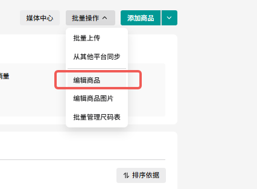
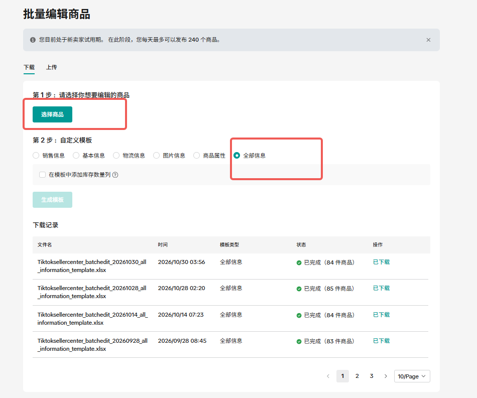
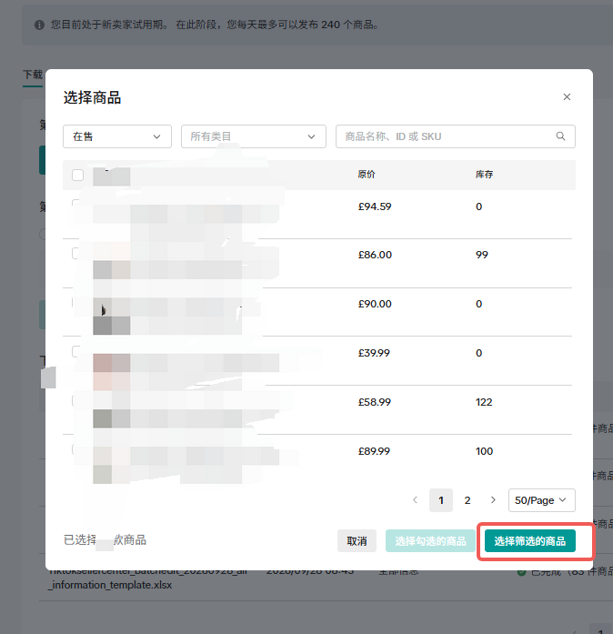
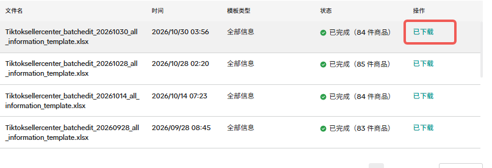

# 如何获取 TikTok 商品信息（Seller Center 导出 → 导入面板）

面板里的「SKU」「商品名」不是从广告接口来的——TikTok 广告 API 只给 `item_group_id`（SPU），
**SKU 编码、商品名称、价格这些只在卖家中心（Seller Center）里**。所以需要从卖家中心导出一份商品表，
再导入插件。这篇就是完整的操作步骤。

> 适用：TikTok Shop 卖家后台（Seller Center）→ 商品 → 批量操作 → 编辑商品。
> 导出的是官方「全部信息」模板（xlsx），一列 `product_id`、一列 `seller_sku`，正好是插件需要的映射。

---

## 一、在 Seller Center 导出商品表（约 2 分钟）

### 第 1 步：菜单入口

**商品 → 批量操作 → 编辑商品**



### 第 2 步：选择商品 + 模板类型

进入「批量编辑商品」页面后，点 **①「选择商品」**：



在弹窗里筛选（一般选「在售」），勾选要导出的商品（或全选），点 **「选择筛选的商品」**：



回到页面后，**② 自定义模板 → 勾「全部信息」**，然后点 **「生成模板」**。

> ⚠️ 一定要选「全部信息」。选「基本信息」等子集虽然文件更小，但可能少 `seller_sku` 列，
> 插件就无法建立 SPU → SKU 的映射。

### 第 3 步：下载生成的 xlsx

生成是异步的，等「下载记录」里的状态变成 **✅ 已完成**，点右侧 **「已下载」**：



文件名类似：

```
Tiktoksellercenter_batchedit_20261030_all_information_template.xlsx
```

这个文件就是待导入的商品表。

---

## 二、导入到面板

### 方式 A：面板上传（推荐）

1. 打开面板（`http://127.0.0.1:8795/` 或 DSH 里的 `8790`）
2. 左侧点 **「商品信息」**
3. 「上传商品表」选择刚才的 xlsx → 上传
4. 上传成功后会显示：`xx 个商品 / xx 个 SKU`，并写入本地缓存

### 方式 B：命令行解析（导出 JSON 留档）

```bash
python3 tools/parse-product-export.py "Tiktoksellercenter_batchedit_20261030_all_information_template.xlsx" products.json
```

解析器会自动找表头行（前面可能有说明行/中文标签行），并同时认英文列名（`product_id` / `seller_sku`）
和中文列名（`商品 ID` / `商家 SKU`）。

---

## 三、导入之后能做什么

| 位置 | 效果 |
|---|---|
| 广告组 → 下钻 → **SKU 汇总表** | 消耗 / 占比 / 订单 / ROI 按 SKU 展示 |
| 广告组 → 下钻 → **素材表「SKU」列** | 每条素材属于哪个 SKU（先按 SPU 反查，再用本表映射到 SKU 编码） |
| **商品信息** 页 | 商品 × 广告合并：每个商品挂上广告消耗 / 订单 / GMV / ROI |
| 导出 Excel | 「商品明细」「SKU 销量」两个 sheet 用到同一份映射 |

---

## 四、文件里至少要有哪些列

| 列（英文 / 中文） | 用途 | 必需 |
|---|---|---|
| `product_id` / 商品 ID | 和广告的 SPU（item_group_id）对齐 | ✅ |
| `seller_sku` / 商家 SKU | 面板上显示的 SKU 编码 | ✅ |
| `product_name` / 商品名称 | 显示商品名 | 建议 |
| `price` / 零售价 | 商品页展示 | 可选 |
| `product_status` / 商品状态 | 过滤下架商品 | 可选 |
| `sku_id` / SKU ID | 多规格商品区分 | 可选 |

导出的「全部信息」模板默认都包含这些列，不需要手工改。

---

## 五、什么时候要重新导出

| 场景 | 要不要重导 |
|---|---|
| 上新商品 / 新 SKU | ✅ 要（否则新素材的 SKU 显示 `-`） |
| 改了商品名 / 价格 | ✅ 建议（面板显示会更新） |
| 只是广告数据变化 | ❌ 不用，广告数据是实时拉的 |
| 下架商品 | 可选（不影响已投放素材的历史映射） |

导出和导入都是本地的，不会改动店铺任何数据，随时可以重复做。

---

## 六、常见问题

**Q：素材表的 SKU 列显示 `-`？**
1. 有没有导入商品表？（商品信息页看有没有记录）
2. 这个 SPU 在商品表里存在吗？（导出时可能没勾到它，或它已下架不在「在售」里）
3. 素材属于该 SPU，但 SPU → SKU 映射缺失：重新导出「全部信息」再导入一次。

**Q：提示「每天最多只能发布 240 个商品」？**
那是新卖家试用期的限制，和导出/导入无关——只是说明你当前在试用期，不影响本功能。

**Q：上传失败 / 解析失败？**
- 确认是 `.xlsx`（不要用 xls 另存的旧格式，不要用 PDF、CSV 混用）
- 文件里必须有 `product_id` 与 `seller_sku` 两列
- 解析需要 Python（openpyxl）：面板会优先用 DSH 自带的 Python，找不到时用系统 `python3`/`python`；
  可用环境变量 `PYTHON_PATH` 指定解释器

**Q：导入的数据存在哪里？**
`%USERPROFILE%\.dsh\plugin-data\tiktok-ads\`
- `product-imports/`：原始 xlsx + 解析出的 JSON
- `sku-map-cache/`：SPU → SKU 的 CSV 缓存（插件各处共用的映射）
